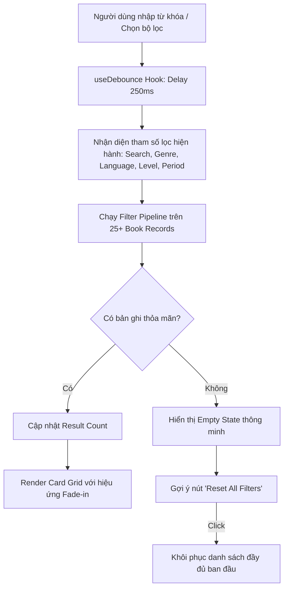
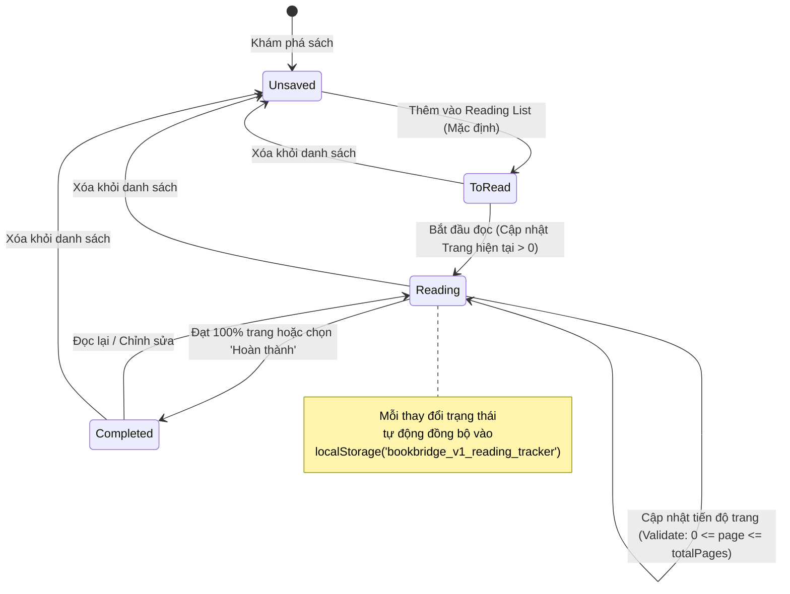

# BẢN PHÂN TÍCH DỰ ÁN TOÀN DIỆN: HỆ THỐNG BOOKBRIDGE
**Tài liệu Phân tích Kỹ thuật & Kiến trúc Sản phẩm (Software Product & Architectural Specification)**
*Dự án: BookBridge – Responsive Book Discovery & Reading Tracker Portal*
*Mô hình: Front-end Single Page Application (React)*
*Chuẩn phát triển: Công nghiệp / Đồ án Doanh nghiệp Aptech eProject*

---

## 1. TỔNG QUAN DỰ ÁN & TẦM NHÌN SẢN PHẨM (EXECUTIVE SUMMARY & PRODUCT VISION)

### 1.1. Bối cảnh & Vấn đề Thực tế (Problem Statement)
Trong thời đại bùng nổ thông tin và nội dung số, độc giả gặp phải tình trạng **"Phân mảnh trải nghiệm đọc" (Reading Fragmentation)**:
- Người đọc phải tìm kiếm qua nhiều nguồn rời rạc: website đánh giá sách, blog tác giả, danh mục nhà sách trực tuyến và các ứng dụng ghi chú cá nhân.
- Khó khăn trong việc lọc sách theo các tiêu chí chuyên sâu (ngôn ngữ, độ tuổi/trình độ đọc, giai đoạn xuất bản, thể loại kết hợp).
- Thiếu một công cụ nhẹ, trực quan, không yêu cầu thủ tục đăng ký/đăng nhập rườm rà nhưng vẫn lưu giữ được danh sách sách yêu thích và theo dõi tiến độ đọc cá nhân ngay trên trình duyệt.

### 1.2. Định vị Sản phẩm (Product Positioning)
**BookBridge** là một Cổng Khám Phá Sách & Quản Lý Kế Hoạch Đọc (Book Discovery & Reading Organization Portal) thế hệ mới, hoạt động như một Single Page Application (SPA) hiệu năng cao, tối ưu hóa trải nghiệm trên mọi kích thước màn hình (Mobile, Tablet, Desktop) và lưu trữ trạng thái người dùng an toàn qua Client-side Local Storage.

### 1.3. Chân dung Người dùng Mục tiêu (User Personas)
| Persona | Nhu cầu chính | Nỗi đau (Pain Points) | Tính năng BookBridge đáp ứng |
| :--- | :--- | :--- | :--- |
| **Hải An (22 tuổi)**<br>*Sinh viên Ngoại ngữ* | Tìm sách song ngữ, phân loại theo trình độ đọc (Beginner -> Advanced) để luyện đọc. | Các trang web bán sách thông thường không lọc được độ khó đọc (Reading Level) và ngôn ngữ chuẩn xác. | Bộ lọc đa chiều (Language Explorer, Reading Level Filter). |
| **Minh Trang (28 tuổi)**<br>*Chuyên viên Marketing* | Khám phá sách mới theo tuyển tập gợi ý (Curated Collections) trong 15-20 phút rảnh rỗi. | Ngại đăng ký tài khoản rườm rà; chỉ muốn lưu nhanh các cuốn tâm đắc vào reading list để mua/đọc sau. | Zero-friction UX (Không cần login), Lưu trữ Bookmark & Phân loại To Read/Reading qua LocalStorage. |
| **Quốc Bảo (35 tuổi)**<br>*Độc giả sách chuyên sâu* | Tìm hiểu sâu về tiểu sử tác giả, phong cách viết và các tác phẩm cùng hệ tư tưởng/chủ đề. | Thông tin tác giả thường bị ẩn hoặc chỉ là một dòng text đơn điệu. | Trang chi tiết tác giả (Author Profiles), Hệ thống gợi ý sách liên quan (Related Books Engine). |

---

## 2. PHÂN TÍCH PHẠM VI DỰ ÁN (SCOPE MANAGEMENT)

### 2.1. Ma trận Trong phạm vi (In-Scope) & Ngoài phạm vi (Out-of-Scope)
```
+---------------------------------------------------------------------------------+
|                                 BOOKBRIDGE SYSTEM                               |
|                                                                                 |
|  [ IN-SCOPE (Trọng tâm dự án) ]                 [ OUT-OF-SCOPE (Không triển khai)]
|  * React 18+ SPA Architecture                   * Backend Database (MySQL, Mongo)
|  * 25+ Sample Records phong phú                 * User Authentication / JWT
|  * Smart Multi-facet Search & Filter            * Live Payment / Cổng thanh toán
|  * Responsive Book Gallery & Lightbox           * Đọc full nội dung sách (Copyright)
|  * LocalStorage Reading Tracker                 * Real-time Push Notification
|  * Author Bibliographies & Discovery            * Gửi mail backend từ Contact form
|  * WCAG 2.1 AA Accessibility Compliant          * Live GPS / External Map APIs
+---------------------------------------------------------------------------------+
```

### 2.2. Phân tích Giá trị Nghiệp vụ (Value Proposition)
Mặc dù là ứng dụng Front-end Client-Side, BookBridge được thiết kế theo tư duy **Production-Ready**:
- **Offline Tolerance**: Dữ liệu tiến độ đọc và danh sách yêu thích duy trì nguyên vẹn kể cả khi mất kết nối mạng hoặc F5 tải lại trang.
- **Zero Latency Feedback**: Tìm kiếm tức thì với thuật toán lọc kết hợp (Compound Filtering), không có độ trễ network request.
- **Privacy-First**: Không thu thập dữ liệu nhạy cảm hay theo dõi người dùng trái phép.

---

## 3. KIẾN TRÚC KỸ THUẬT HỆ THỐNG (SYSTEM ARCHITECTURE)

### 3.1. Technical Stack Lựa chọn & Lý do
- **Core Framework**: React 18+ (Hooks, Suspense, Concurrent rendering).
- **Build Tool**: Vite (Tốc độ khởi động & HMR tức thì, bundle nhỏ gọn).
- **Styling Architecture**: Modern Vanilla CSS với CSS Design Tokens (CSS Variables) & Modular Styles, kết hợp Glassmorphism và chuyển động vi mô (Micro-interactions) cao cấp.
- **Icons**: Lucide Icons hoặc SVG vector tùy biến (độ nét cao, không phụ thuộc font cồng kềnh).
- **State Management**: React Context API (`FavoritesContext`, `ReadingProgressContext`, `FilterContext`) kết hợp Custom Hooks (`useLocalStorage`, `useDebounce`, `useBookSearch`).
- **Storage Layer**: Web Storage API (`window.localStorage`) có bọc lớp phòng vệ lỗi (Safe Serialization / Deserialization & Quota Exception Handling).

### 3.2. Cấu trúc Thư mục Chuẩn Doanh nghiệp (Enterprise Folder Structure)
```text
c:/e project/
├── docs/
│   └── PROJECT_ANALYSIS.md
├── index.html
├── package.json
├── vite.config.js
├── public/
│   ├── favicon.svg
│   └── images/
│       ├── books/       # Ảnh bìa sách chất lượng cao
│       ├── authors/     # Ảnh chân dung tác giả
│       └── gallery/     # Ảnh gallery minh họa & concept art
└── src/
    ├── main.jsx         # Entry point của ứng dụng
    ├── App.jsx          # Root Layout & Routing Manager
    ├── index.css        # Design tokens, reset, typography, global utilities
    ├── constants/       # Enum, bộ lọc mặc định, cấu hình UI
    │   ├── genres.js
    │   ├── languages.js
    │   └── readingLevels.js
    ├── data/            # Local Mock Database (Structured Data)
    │   ├── booksData.js # 25+ bản ghi sách đầy đủ chi tiết
    │   ├── authorsData.js
    │   ├── collectionsData.js
    │   └── galleryData.js
    ├── context/         # Centralized State Providers
    │   ├── BookContext.jsx
    │   ├── FavoritesContext.jsx
    │   └── ReadingTrackerContext.jsx
    ├── hooks/           # Reusable Business Logic
    │   ├── useLocalStorage.js
    │   ├── useDebounce.js
    │   └── useModal.js
    ├── services/        # Data access layer & Storage adapter
    │   └── storageService.js
    ├── utils/           # Helper functions
    │   ├── filterEngine.js
    │   ├── validators.js
    │   └── formatters.js
    └── components/      # UI Component Library (Atomic/Modular)
        ├── common/      # Header, Footer, Breadcrumbs, Badge, Rating, Button
        ├── home/        # HeroSection, FeaturedCarousel, CategoryExplorer
        ├── directory/   # FilterSidebar, SearchBar, BookGrid, BookCard, EmptyState
        ├── details/     # BookDetailModal, Synopsis, MetadataList, RelatedBooks
        ├── authors/     # AuthorModal, AuthorCard, AuthorBibliography
        ├── gallery/     # GalleryGrid, LightboxModal, ImageCredits
        ├── tracker/     # ReadingListDrawer, ProgressProgressBar, StatusBadge
        └── contact/     # ContactFormModal, DemoAlertModal
```

---

## 4. MÔ HÌNH DỮ LIỆU & QUAN HỆ THỰC THỂ (DATA ARCHITECTURE)

### 4.1. Sơ đồ Quan hệ Thực thể (Entity Relationship Diagram - ERD)

```mermaid
erDiagram
    AUTHOR ||--o{ BOOK : "writes"
    COLLECTION }o--o{ BOOK : "contains"
    BOOK ||--o| READING_PROGRESS : "tracked in"
    BOOK ||--o| FAVORITE : "bookmarked as"
    GALLERY_ITEM }|--|| BOOK : "illustrates"

    AUTHOR {
        string id PK
        string name
        string avatar
        string nationality
        string specialization
        string bio
        string[] notableThemes
    }

    BOOK {
        string id PK
        string title
        string authorId FK
        string isbn
        string language
        string genre
        string readingLevel
        int publicationYear
        int pageCount
        string coverImage
        string synopsis
        string[] themes
        string targetAudience
        float rating
        boolean isFeatured
    }

    COLLECTION {
        string id PK
        string title
        string description
        string badge
        string[] bookIds FK
    }

    READING_PROGRESS {
        string bookId PK_FK
        string status "To Read | Reading | Completed"
        int currentPage
        int totalPages
        string updatedAt
        string notes
    }

    FAVORITE {
        string bookId PK_FK
        string addedAt
    }

    GALLERY_ITEM {
        string id PK
        string bookId FK
        string imageUrl
        string caption
        string credit
        string aspect
    }
```

### 4.2. Local Storage Schema & Cơ chế Phòng vệ Dữ liệu (Resilience)
Dữ liệu lưu trữ trong trình duyệt người dùng gồm 2 namespace chính:
1. `bookbridge_v1_favorites`: Danh sách mảng các `bookId` (vd: `["bk-01", "bk-07", "bk-14"]`).
2. `bookbridge_v1_reading_tracker`: Dictionary ánh xạ `bookId` sang trạng thái:
```json
{
  "bk-01": {
    "status": "Reading",
    "currentPage": 142,
    "totalPages": 328,
    "percentage": 43,
    "lastUpdated": "2026-10-06T12:00:00Z"
  },
  "bk-05": {
    "status": "Completed",
    "currentPage": 280,
    "totalPages": 280,
    "percentage": 100,
    "lastUpdated": "2026-10-05T08:30:00Z"
  }
}
```

**Nguyên tắc xử lý ngoại lệ (Fault Tolerance)**:
- Nếu người dùng bật chế độ ẩn danh (Incognito/Private Browsing) hoặc chặn LocalStorage: Ứng dụng tự động fallback sang Session/Memory State, hiển thị Toast cảnh báo thân thiện thay vì làm sập ứng dụng (Crash).
- Xử lý kiểm tra giới hạn: `currentPage` không được âm và không được vượt quá `totalPages`.

---

## 5. PHÂN TÍCH LUỒNG NGHIỆP VỤ CỐT LÕI (CORE USER FLOWS)

### 5.1. Luồng Lọc và Tìm Kiếm Đa Tiêu Chí (Search & Compound Filter Pipeline)



### 5.2. Luồng Quản lý Tiến độ Đọc Sách & Đồng bộ LocalStorage



---

## 6. THIẾT KẾ TRẢI NGHIỆM NGƯỜI DÙNG & TIÊU CHUẨN AESTHETICS (UI/UX DESIGN SYSTEM)

### 6.1. Triết lý Thiết kế: "Literary Elegance & Modern Precision"
- Tránh phong cách khô khan, cổ hủ thường thấy ở các web thư viện cũ.
- Áp dụng phong cách **Modern Editorial Dark/Light Harmony**: Nền giấy cao cấp (Warm Cream / Deep Midnight Navy), điểm xuyết màu đồng thau (Amber Gold) và xanh cổ vịt (Teal/Emerald) mang lại cảm giác học thuật nhưng hiện đại, sang trọng.

### 6.2. Bảng Mã Màu (Color Palette Tokens)
| Token Name | Hex Code | Ứng dụng |
| :--- | :--- | :--- |
| `--color-primary` | `#1E293B` (Midnight Slate) | Header, Tiêu đề chính, Text tương phản cao |
| `--color-accent` | `#D97706` / `#F59E0B` (Warm Amber) | Nút hành động (CTA), Rating stars, Active badges |
| `--color-secondary` | `#0D9488` (Teal Gem) | Thẻ phân loại ngôn ngữ, Tag thể loại |
| `--color-bg-main` | `#F8FAFC` (Slate Tint Soft) | Nền tổng thể trang, giảm mỏi mắt khi đọc lâu |
| `--color-surface` | `#FFFFFF` (Pure Card White) | Thẻ sách, Drawer, Modal content |
| `--color-glass` | `rgba(255, 255, 255, 0.85)` | Navigation bar dính (Sticky glassmorphism header) |

### 6.3. Kiểu chữ (Typography Hierarchy)
- **Display & Headings**: `Outfit` hoặc `Playfair Display` (Font serif/sans hiện đại, sang trọng cho tiêu đề sách và hero banner).
- **Body & Metadata**: `Inter` hoặc `Plus Jakarta Sans` (Tối ưu độ đọc trên màn hình di động ở kích thước nhỏ).

### 6.4. Tiêu chuẩn Khả dụng & Tiếp cận (Accessibility - WCAG 2.1 AA)
- Tỷ lệ tương phản chữ/nền tối thiểu **4.5:1** cho văn bản thông thường và **3:1** cho văn bản lớn.
- **Visible Focus Rings**: Viền focus rõ ràng khi duyệt bằng phím Tab.
- **A11y cho Lightbox & Modal**:
  - Nhấn phím `Escape` để đóng ngay lập tức.
  - Phím mũi tên `Left/Right` để chuyển ảnh trong Gallery.
  - Focus Trap: Không để con trỏ phím nhảy ra ngoài modal khi đang mở.
  - Mọi ảnh đều có thuộc tính `alt` có nghĩa và credit nguồn rõ ràng.

---

## 7. ĐẶC TẢ CHI TIẾT 14 MODULE CHỨC NĂNG (FUNCTIONAL REQUIREMENTS)

| STT | Module | Mục tiêu cốt lõi | Chi tiết triển khai kỹ thuật & Tiêu chí nghiệm thu (Acceptance Criteria) |
| :---: | :--- | :--- | :--- |
| **01** | **Home & Landing Page** | Nhận diện thương hiệu & Thu hút người dùng | - Hero Banner ấn tượng kèm nút tìm kiếm nhanh & CTA dẫn tới Directory.<br>- Thống kê nhanh (25+ Đầu sách, 8+ Ngôn ngữ, 10+ Thể loại).<br>- Slider/Grid các bộ sưu tập nổi bật (Curated Collections). |
| **02** | **Books Directory** | Danh mục sách trung tâm | - Grid hiển thị responsive (1 cột mobile, 2 cột tablet, 3-4 cột desktop).<br>- Card hiển thị: Ảnh bìa, Tựa đề, Tác giả, Ngôn ngữ, Thể loại, Badge tiến độ (nếu có).<br>- Tối thiểu 25 bản ghi sách mẫu với ID ổn định (`bk-01` đến `bk-25`). |
| **03** | **Smart Search & Filter** | Công cụ tìm kiếm & lọc kết hợp | - Search không phân biệt hoa thường, hỗ trợ tìm theo Tên, Từ khóa hoặc Ngôn ngữ.<br>- 4 Bộ lọc: Thể loại (Genre), Ngôn ngữ (Language), Trình độ đọc (Beginner/Intermediate/Advanced), Giai đoạn (Classic, Modern, Contemporary).<br>- Hiển thị số lượng kết quả trùng khớp (vd: *Found 8 books*); Nút *Clear All Filters*. |
| **04** | **Book Details View** | Xem thông tin chi tiết toàn diện | - Mở dưới dạng Modal/Full Overlay mượt mà với URL hash hoặc state.<br>- Tóm tắt nội dung (Synopsis), Số trang, Đối tượng độc giả, Chủ đề chính (Themes).<br>- Gợi ý 3-4 cuốn sách liên quan (cùng tác giả hoặc cùng thể loại).<br>- Nút Bookmark yêu thích & Thêm vào Kế hoạch đọc. |
| **05** | **Author Profiles** | Tiểu sử & Tác phẩm của tác giả | - Modal/Trang hồ sơ tác giả: Tên, Quốc tịch, Lĩnh vực chuyên môn, Tiểu sử ngắn.<br>- Danh sách tất cả các tác phẩm của tác giả đó đang có trong hệ thống BookBridge.<br>- Click vào từng tác phẩm mở trực tiếp Book Details. |
| **06** | **Interactive Book Gallery** | Thư viện hình ảnh nghệ thuật & Bìa sách | - Bố cục thư viện ảnh Masonry hoặc Grid tương tác.<br>- Lightbox xem ảnh lớn với Next/Previous, phím bấm Escape, Caption & Bản quyền ảnh (Credits). |
| **07** | **Language & Genre Explorer** | Khám phá trực quan theo ngôn ngữ | - Thanh chọn ngôn ngữ (Visual Language Selector: Tiếng Anh, Pháp, Nhật, Đức, Tây Ban Nha, Việt Nam...).<br>- Trạng thái Active rõ ràng, lọc tức thì các tác phẩm thuộc ngôn ngữ đã chọn. |
| **08** | **Featured Collections** | Tuyển tập đọc tuyển chọn | - Hiển thị 4 bộ sưu tập: *Timeless Classics, Fast & Engaging Reads, Modern Literary Gems, Polyglot Starter Kit*.<br>- Tái sử dụng component thẻ sách linh hoạt. |
| **09** | **Favourites & Bookmarks** | Lưu trữ sách yêu thích | - Nút Tim (Heart icon) chuyển đổi trạng thái tức thì.<br>- Lưu trữ `bookId` vào LocalStorage; giữ nguyên dữ liệu sau khi F5 tải lại trang.<br>- Màn hình danh sách Bookmark riêng biệt kèm Empty state nếu chưa có sách nào. |
| **10** | **About BookBridge** | Giới thiệu dự án & Tuyên bố học thuật | - Sứ mệnh, công nghệ sử dụng (React, Vite, LocalStorage, CSS3).<br>- Nguồn gốc dữ liệu mẫu (Sample data acknowledgements) và ghi nhận bản quyền hình ảnh. |
| **11** | **Contact Us & Demo Validation**| Biểu mẫu liên hệ & Phản hồi | - Form gồm: Họ tên, Email, Chủ đề, Lời nhắn.<br>- Client-side validation: Bắt buộc điền, định dạng email chuẩn Regex.<br>- Modal thông báo thử nghiệm thành công (Khẳng định rõ: *Front-end Demo Only, no backend server message dispatched*). |
| **12** | **Navigation & Common UI** | Trải nghiệm điều hướng nhất quán | - Header cố định (Sticky glass header) với Menu điều hướng, thanh tìm kiếm nhanh, nút mở Saved Books.<br>- Mobile Drawer Menu cảm ứng (Touch-friendly hamburger menu).<br>- Breadcrumb dẫn đường, Footer đầy đủ bản quyền và liên kết nhanh. |
| **13** | **Reading Tracker Features**| Quản lý trạng thái & Tiến độ đọc | - 3 Trạng thái đọc: *To Read, Reading, Completed*.<br>- Nhập số trang đã đọc, tính toán % hoàn thành và hiển thị thanh tiến độ trực quan.<br>- Validate ràng buộc: Số trang đọc ≤ Tổng số trang của sách. |
| **14** | **AI Assisted Development** | Ứng dụng công nghệ AI minh bạch | - Khai thác AI trong việc tạo wireframe thiết kế, sinh mock data phong phú, chuẩn hóa tài liệu và tối ưu code theo đúng chuẩn đạo đức lập trình. |

---

## 8. KẾ HOẠCH TRIỂN KHAI THEO PHƯƠNG PHÁP AGILE/SPRINT (WBS ROADMAP)

- **Sprint 1 (Khởi tạo kiến trúc & Dữ liệu)**: Khởi tạo Vite + React + Design Tokens CSS. Xây dựng bộ dữ liệu 25+ cuốn sách, 8+ tác giả chuẩn hóa (`booksData.js`, `authorsData.js`).
- **Sprint 2 (Core Layout & Landing Showcase)**: Header kính mờ (Sticky Glassmorphism), Mobile menu, Hero section, Curated collections.
- **Sprint 3 (Directory & Smart Compound Filter)**: Grid danh mục sách responsive, Search Debounce, Multi-facet Filter Sidebar (Genre, Language, Level, Period).
- **Sprint 4 (Book Details, Author View & Gallery Lightbox)**: Modal chi tiết sách, thuật toán gợi ý sách liên quan, Modal tác giả, Lightbox thư viện ảnh (hỗ trợ phím Escape, Mũi tên).
- **Sprint 5 (LocalStorage Engine - Bookmark & Reading Tracker)**: React Context + Hook lưu trữ LocalStorage, Trình theo dõi tiến độ (To Read / Reading / Completed), Form Contact có validation client.
- **Sprint 6 (Testing, Tối ưu & Đóng gói Báo cáo)**: Kiểm thử đa trình duyệt (Chrome, Edge, Firefox, Safari Mobile), Audit độ tương phản WCAG 2.1 AA, Đóng gói file zip, README và chuẩn bị kịch bản quay video demo.

---

## 9. MA TRẬN QUẢN TRỊ RỦI RO (RISK MANAGEMENT MATRIX)

| Rủi ro Kỹ thuật | Xác suất | Tác động | Giải pháp Phòng ngừa & Xử lý (Mitigation Strategy) |
| :--- | :---: | :---: | :--- |
| **Dung lượng LocalStorage vượt hạn mức** | Thấp | Vừa | Chỉ lưu `bookId` và metadata tối thiểu (số trang, trạng thái), không lưu ảnh base64 hay object sách đầy đủ. Bọc lệnh ghi trong `try...catch`. |
| **Lỗi ảnh hỏng (Broken Images / 404)** | Trung bình | Cao | Tạo `ImageWithFallback` component: Nếu URL ảnh bìa lỗi, tự động chuyển về ảnh bìa dự phòng vector tinh tế (Fallback Cover SVG). |
| **Độ trễ khi lọc tìm kiếm trên máy yếu** | Thấp | Vừa | Áp dụng `useDebounce` 200-300ms cho ô tìm kiếm; thuật toán lọc duyệt qua mảng tĩnh bằng các toán tử native cực nhanh (Filter/Includes). |
| **Vỡ giao diện trên màn hình nhỏ (Overflow)** | Trung bình | Cao | Áp dụng CSS `clamp()`, `minmax()`, Flex wrap và Grid tự co giãn. Kiểm tra kỹ lưỡng trên DevTools từ độ phân giải 360px đến 4K. |
| **Trùng lặp hoặc mất đồng bộ trạng thái đọc** | Thấp | Vừa | Gom toàn bộ logic vào `ReadingTrackerContext` tập trung làm Single Source of Truth; mọi component chỉ đọc và gửi action qua hook. |

---

## 10. HỒ SƠ BÀN GIAO ĐỒ ÁN EPTECT (DELIVERABLES CHECKLIST)

1. **Mã nguồn hoàn chỉnh (Source Code)**:
   - Clean Code, React 18+ Functional Components & Hooks.
   - Script chạy chuẩn: `npm install` -> `npm run dev` -> `npm run build`.
2. **Bộ dữ liệu mẫu (Test Dataset)**:
   - 25 cuốn sách hoàn chỉnh thuộc 5+ ngôn ngữ, 6+ thể loại, đầy đủ thông tin tác giả, số trang, tóm tắt nội dung và ảnh bìa đồng bộ.
3. **Tài liệu Báo cáo Dự án (Project Report)**:
   - SRS, SDS, Sơ đồ Flowchart, DFD, ERD, Test cases và Kết quả kiểm thử.
   - File hướng dẫn nộp bài (`ReadMe.doc` / `README.md`).
4. **Video Clip Demo**:
   - Video thuyết minh 3-5 phút quay toàn bộ luồng nghiệp vụ.
